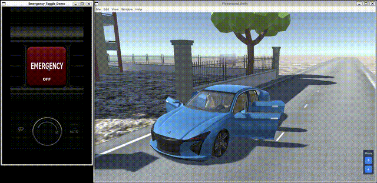

# Yoriito Tutorial Application



Reference implementation repository for the yoriito API Working Group.

## Components

- **[ref_ui](ref_ui/README.md)**  
  Reference UI built with Flutter.

- **[ref_app](ref_app/README.md)**  
  Reference HeadlessApp demonstrating core functionality.

- **[ref_pal](ref_pal/README.md)**  
  Reference PAL (Platform Abstraction Layer) implementation.

## Getting Started

Run the components in the following order:

1. PAL (`ref_pal`)
2. HeadlessApp (`ref_app`)
3. UI (`ref_ui`)

## How to Run

### Run on WSL

All components run on WSL.

#### 1) Run the PAL

```bash
cd /work/yoriito-tutorial/ref_pal
npm install
./init_pal.sh
npx electron . --no-sandbox
```

---

#### 2) Run the HeadlessApp

```bash
cd /work/yoriito-tutorial/ref_app
cmake -S . -B build
cmake --build build -j
./build/ref_app
```

---

#### 3) Run the UI

```bash
cd /work/yoriito-tutorial/ref_ui
flutter clean
flutter pub get
flutter run -d linux
```

### Run on Yocto

`ref_pal` does not support Raspberry Pi.”
`ref_pal` must run on the PC first and connect to the target device such as Raspberry Pi.

#### 1) Run the PAL on the PC

```bash
cd /work/yoriito-tutorial/ref_pal
npm install
./init_pal.sh
npx electron . --no-sandbox
```

---

#### 2) Run the HeadlessApp on Yocto.

```bash
ref_app
```

---

#### 3) Run the UI on Yocto.

```bash
flutter-pi --release $REF_UI_PATH
```

Example
```bash
flutter-pi --release /usr/share/flutter/yoriito-emergency-app/3.38.3/release
```


## Quality Assessment
 
This repository contains quality assessment results for this project.
Please refer to the [quality assessment page](./quality/quality_assessment.md).

The results are provided for transparency and reference purposes and do not constitute any warranty or guarantee of quality.

### Contents
 
- Dynamic Analysis
- Performance
 
### Notes
 
Some files in this directory may be generated automatically by CI tools.